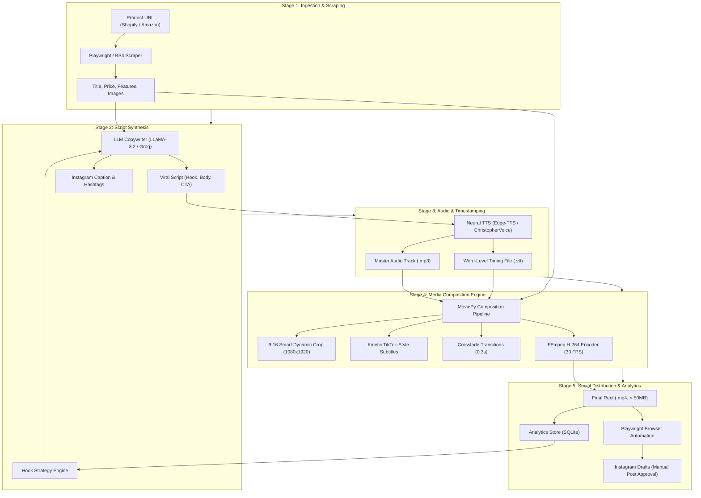

# Auto-Reel: AI-Powered Short-Form Video Synthesis & Distribution Pipeline

[](https://opensource.org/licenses/MIT)
[](https://www.python.org/)
[](https://fastapi.tiangolo.com/)
[](https://vitejs.dev/)
[](https://zulko.github.io/moviepy/)
[](https://playwright.dev/)

> **Autonomous multi-stage media pipeline that ingests e-commerce product links, generates high-retention copywriting scripts, synthesizes synchronized voiceovers, renders vertical (9:16) video clips with kinetic subtitles, and stages drafts to social platforms.**

| Service | Environment | Status | Configuration |
| :--- | :--- | :--- | :--- |
| **Pipeline Orchestration API** | FastAPI / Uvicorn |  | `http://localhost:8000` |
| **Interactive Production Studio** | React / Vite |  | `http://localhost:5173` |
| **Media Rendering Engine** | MoviePy / FFmpeg H.264 |  | 1080x1920 (9:16) @ 30 FPS |
| **Social Distribution Worker** | Playwright Chromium |  | Instagram Drafts Staging |
| **Hook Strategy Feedback Loop** | SQLite (`data/analytics.db`) |  | Closed-Loop Retention Analysis |

---

## Executive Summary

**Auto-Reel** is an end-to-end artificial intelligence video production pipeline engineered to solve the operational bottleneck of organic short-form marketing. Producing high-converting TikToks, Instagram Reels, and YouTube Shorts requires continuous script ideation, professional audio synthesis, word-by-word subtitle synchronization, and video layout composition.

Auto-Reel automates this workflow into a single 30-to-45-second execution pass. Given an Amazon, Shopify, or arbitrary e-commerce product URL, the system scrapes product imagery and value propositions, applies psychological hook frameworks via local or cloud LLMs (Ollama LLaMA-3.2 or Groq), generates studio-grade neural text-to-speech with millisecond timestamp markers, composites vertical 1080x1920 video with dynamic subtitle animations, and uploads the rendered MP4 directly to platform drafts for human review.

---

## System Architecture

Auto-Reel operates across a modular six-stage sequential pipeline with telemetry feedback:



---

## Detailed Pipeline Stages

### 1. Ingestion & Feature Extraction (`scraper.py`)
- Ingests direct product URLs or JSON payloads.
- Extracts product title, pricing, key differentiators, reviews, and high-resolution product photography.
- Sanitizes image assets and normalizes aspect ratios.

### 2. Copywriting & Behavioral Framing (`copywriter.py`)
- Employs proven psychological hook frameworks:
  - *Pattern Interrupt / Contradiction:* "Stop buying cheap wireless earbuds..."
  - *Loss Aversion:* "You are losing 40% of battery efficiency without this..."
  - *Urgency / Social Proof:* "The gadget that went viral for one reason..."
- Enforces strict timing constraints: 45 to 65 words to maintain a tight 15-to-20-second viewing velocity.

### 3. Voice Synthesis & Word-Level Alignment (`voice_generator.py`)
- Uses Microsoft Edge Neural Text-to-Speech (`en-US-ChristopherNeural` / `en-US-JennyNeural`).
- Generates exact millisecond subtitle timing files (`.vtt`) capturing individual word boundaries to synchronize visual text pop-ins with audio inflection.

### 4. 9:16 Video Rendering & Dynamic Subtitles (`video_builder.py`)
- **Aspect Scaling:** Automatically transforms horizontal or square product photography into high-density 1080x1920 vertical canvas layouts using blurred background letterboxing or centered zooms.
- **Kinetic Subtitles:** Groups spoken words into 3-to-5 word clusters, rendering high-contrast white typography with black strokes and yellow accent highlights at center-bottom coordinates.
- **Transitions:** Applies 0.3-second crossfades between visual scenes to ensure smooth pacing.
- **Encoding:** Employs H.264/AAC encoding targeting < 50MB output to comply with Instagram and TikTok upload specifications.

### 5. Automated Distribution (`distributor.py`)
- Leverages Playwright to stage the rendered MP4 and generated caption into Instagram Drafts.
- **Safety Protocol:** Staged as a draft rather than direct publication, guaranteeing that a human administrator verifies the final video before it becomes public.

### 6. Closed-Loop Performance Analytics (`analytics.py`)
- Tracks viewer retention, completion rates, and outbound click metrics in SQLite.
- An analytical agent evaluates weekly performance trends and updates the prompt injection strategy (e.g., increasing controversy weight if watch times drop).

---

## Production API Reference

| Endpoint | Method | Description | Sample Request | Key Response |
| :--- | :---: | :--- | :--- | :--- |
| `/api/generate` | `POST` | Ingests URL and triggers full synthesis pipeline | `{"url": "https://..."}` | `job_id`, `status: "queued"` |
| `/api/status/{job_id}` | `GET` | Telemetry polling for active rendering stage | `GET /api/status/104` | `stage: "rendering"`, `progress: 75%` |
| `/api/video/{job_id}` | `GET` | Streams rendered MP4 video file | `GET /api/video/104` | `video/mp4` binary stream |
| `/api/distribute/{job_id}`| `POST` | Uploads generated video to Instagram Drafts | `{"job_id": 104}` | `status: "draft_saved"` |
| `/api/analytics` | `GET` | Returns engagement telemetry and current hook strategy | `GET /api/analytics` | `current_hook_strategy`, `metrics` |

---

## Technology Stack

| Layer | Technologies |
| :--- | :--- |
| **API & Backend** | Python 3.10+, FastAPI, Uvicorn, Pydantic v2 |
| **Inference Models** | Ollama (LLaMA-3.2 3B), Groq API (Fallback) |
| **Audio & Speech** | Edge-TTS, Whisper VTT Parser |
| **Computer Vision & Video** | MoviePy, FFmpeg, Pillow, ImageMagick |
| **Frontend Studio** | React, Vite, Tailwind CSS, Lucide Icons |
| **Automation & Scraping** | Playwright (Chromium), BeautifulSoup4 |
| **Data Persistence** | SQLite (`analytics.db`), JSON File Store |

---

## Quick Start & Installation

### Prerequisites
- Windows 10/11, macOS, or Linux
- Python 3.10+
- Node.js 18+ & npm
- FFmpeg installed and available on system PATH

### 1. Clone the Repository
```bash
git clone https://github.com/Manimaran-tech/Auto-Reel.git
cd Auto-Reel
```

### 2. Configure Backend Environment
```bash
# Create and activate Python virtual environment
python -m venv .venv
source .venv/bin/activate  # On Windows: .venv\Scripts\activate

# Install dependencies and Playwright browser binaries
pip install -r backend/requirements.txt
playwright install chromium
```

### 3. Configure Environment Variables
Create `.env` in the project root:
```env
# LLM Configuration
OLLAMA_BASE_URL=http://localhost:11434
OLLAMA_MODEL=llama3.2:3b
GROQ_API_KEY=your_groq_key_optional

# Audio Configuration
TTS_VOICE=en-US-ChristopherNeural

# Instagram Staging (Optional)
INSTAGRAM_USERNAME=your_username
INSTAGRAM_PASSWORD=your_password

# Directories
OUTPUT_DIR=./output
ASSETS_DIR=./assets
```

### 4. Run Development Servers
```bash
# Terminal 1: Launch Backend API
uvicorn backend.main:app --host 0.0.0.0 --port 8000 --reload

# Terminal 2: Launch Frontend Studio
cd frontend
npm install
npm run dev
```

Open **http://localhost:5173** to access the interactive Auto-Reel production studio.

---

## License

This project is licensed under the MIT License — see the [LICENSE](LICENSE) file for details.